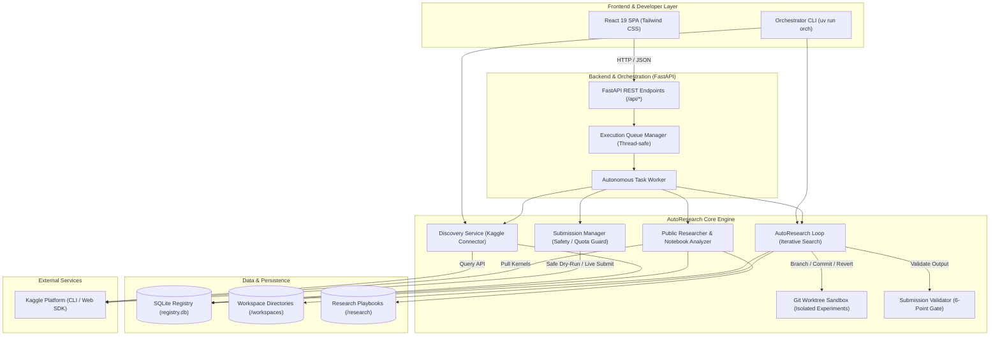
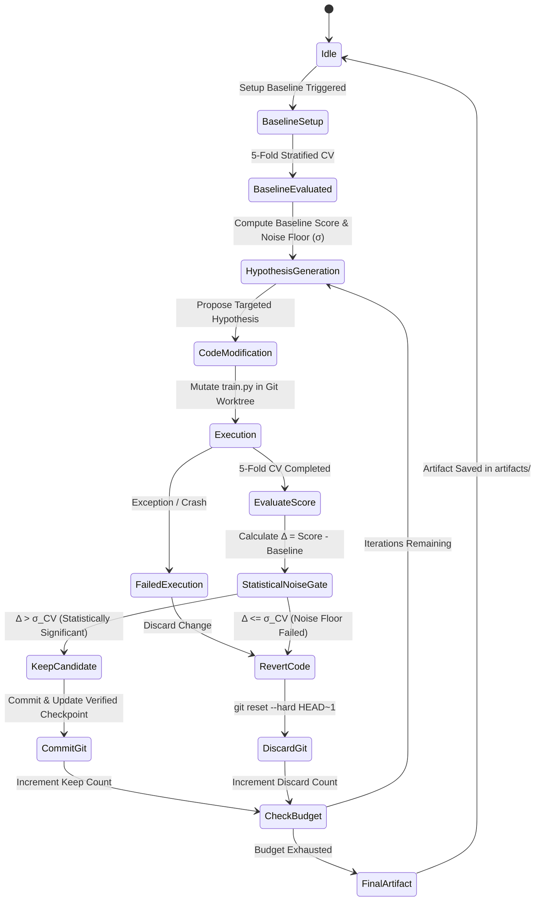
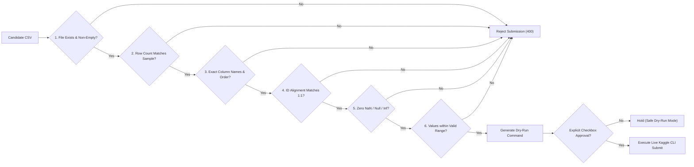

# System Architecture & State Machine Diagrams

This document outlines the end-to-end architecture and operational state flows of the **Kaggle AutoResearch Orchestrator**. Generated under the gstack `/diagram` specialist specifications.

---

## 1. High-Level System Architecture

---

## 2. AutoResearch Iteration Loop State Machine

---

## 3. Pre-Flight 6-Point Schema Verification Gate

